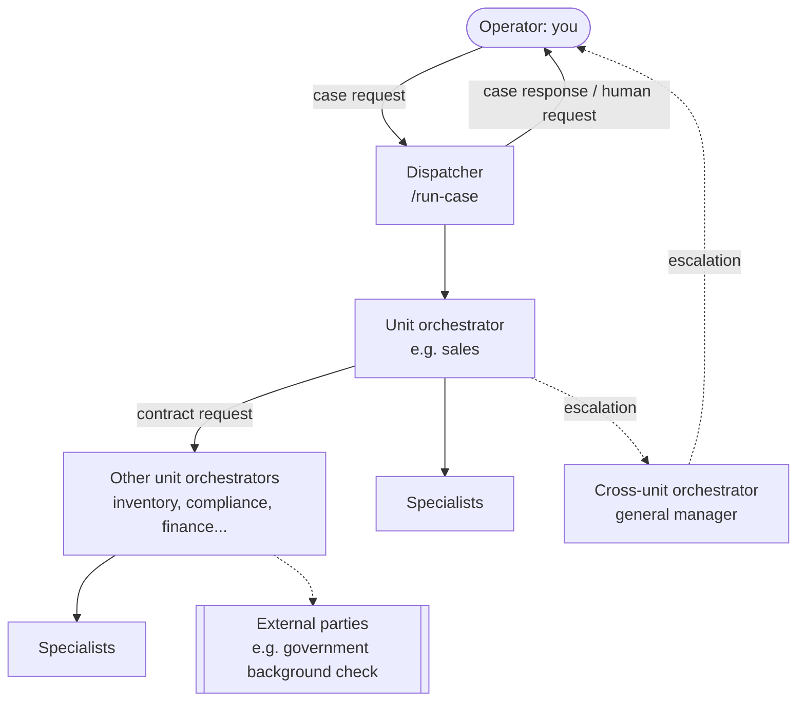

# cc-agents-poc

A proof of concept for a **framework in which AI agents run an entire operation, with humans only at the boundary**: approvals, judgment calls, physical actions, and real-world information.

The framework itself is **context-agnostic**: it knows nothing about businesses, stores, or teams. Whatever runs on it is a *context*. The first context is a **mock firearm store**, chosen for its variety of roles and interactions: sales, inventory, compliance with background checks, financing, purchasing, inspections, and external experts.

> **Everything is mock.** No real transactions, payments, regulatory determinations, or live services. Background-check results are fictional and never eligibility decisions. Physical inspections are a human role; agents only record mock results.

**No programming language is used.** The framework runs on [Claude Code](https://code.claude.com) agents and skills that follow Markdown instructions and read and write JSON case files.

## How It Works



- **The operator** (you) opens a case with a request, e.g. "a quotation for a handgun, paying cash", and receives a **case response**: the deliverable, what blocks it, or what information is still needed.
- **Orchestrators** plan, delegate, validate outputs against expected outputs and rules, and are the only roles that change state. They have bounded autonomy and escalate anything outside their authority.
- **Specialists** do one focused job and return an output. **External parties** are simulated outsiders whose outputs are always validated.
- **Departments ("units") interact only through interaction contracts** and escalations.
- **The dispatcher** (the main conversation) runs every agent invocation, in parallel when tasks are independent, and logs everything to an append-only event log.
- **All state lives in files**, one writer per file, so every step is auditable.

## Quick Start

Requires [Claude Code](https://code.claude.com) 2.1 or later.

```text
/run-case firearm-store Jordan Test (FAKE-ID-1001, born 1985-04-12) wants a quotation for the Mockworks M9 Compact, paying cash
```

The main conversation becomes the dispatcher. It reports which tasks are running and shows you the case response. Answer as the operator, e.g. "Continue, the customer paid", to take the sale through payment, delivery, and recording.

Every run creates a case folder under `data/firearm-store/cases/<case-id>/` with the request, the task list, the event log, and each task's input and output.

More scenarios, with expected results and an audit checklist: [`contexts/firearm-store/test-scenarios.md`](contexts/firearm-store/test-scenarios.md).

## Repository Layout

```text
CLAUDE.md                     # framework concepts and conventions (start here)
.claude/
  agents/                     # one agent per role: spec + expected outputs
  skills/                     # dispatcher (run-case), case protocol, orchestrator turn, guides
  rules/<context>/            # enforced rules, auto-loaded when agents touch the context's data
contexts/
  firearm-store/
    CLAUDE.md                 # context guidance: vocabulary, entry units, conventions
    organization.md           # org diagram, interaction matrix, escalation paths
    units/                    # departments and the records each owns
    interaction-contracts/    # how departments ask each other for work
    human-roles/              # roles only a person can fill
    mock-data.md              # what is mocked, who owns it, test identities
    test-scenarios.md         # runs to try, with expected results
data/
  firearm-store/
    records/                  # shared mock records (catalog, inventory, ledger...)
    external/                 # data behind external parties (fictional criminal records)
    cases/                    # one folder per simulated case
runtimes/
  claude-code/README.md       # how the framework maps onto Claude Code
```

## Where to Read Next

| To understand | Read |
|---|---|
| The framework's concepts (operator, roles, authority, escalation, human boundary, cases) | [`CLAUDE.md`](CLAUDE.md) |
| How the framework maps onto Claude Code | [`runtimes/claude-code/README.md`](runtimes/claude-code/README.md) |
| The firearm store's organization | [`contexts/firearm-store/organization.md`](contexts/firearm-store/organization.md) |
| What data is mocked | [`contexts/firearm-store/mock-data.md`](contexts/firearm-store/mock-data.md) |
| How a case is run step by step | [`.claude/skills/run-case/SKILL.md`](.claude/skills/run-case/SKILL.md) and [`.claude/skills/case-protocol/SKILL.md`](.claude/skills/case-protocol/SKILL.md) |

## Status

Design and early testing. The organizational map, rules, guides, mock data, and Claude Code agents are drafted, and a full sale (quote → payment → delivery → recording) has run end to end. Not built yet: workflow templates, a task budget per case, resuming an open case after `/clear`, time-based rules (e.g., reservation expiry), and adapters for other runtimes.
