# Firearm Store Organization

Overview of the firearm-store organizational map: hierarchy, interaction matrix, and escalation paths. Details live in:

- `units/`: one file per department (members and the records it owns).
- `.claude/agents/firearm-store-<role-id>.md`: one agent per non-human role, with its spec and expected outputs; `human-roles/` for human roles.
- `interaction-contracts/`: one file per contract.
- `.claude/rules/firearm-store/` (rules) and `.claude/skills/firearm-store-<guide-id>/` (guides): extension points; expected outputs are in each agent file, and the case response / human request in the `orchestrator-turn` skill.
- `mock-data.md`: everything that must be mocked, who owns it, and where it lives.

Status: **draft**.

## Organization Diagram

Solid lines are reporting lines. Dotted lines are reached only through a contract (external parties) or the human boundary (humans).

```mermaid
flowchart TD
    OP([Operator: owner / CEO]):::operator
    GM[General manager<br/>cross-unit orchestrator]
    OP --- GM

    GM --- SO[Sales orchestrator]
    GM --- IO[Inventory orchestrator]
    GM --- CO[Compliance orchestrator]
    GM --- FO[Finance orchestrator]
    GM --- PO[Purchasing orchestrator]
    GM --- TO[Technical services orchestrator]

    SO --- S1[Sales consultant]
    SO --- S2[Customer support]

    IO --- I1[Stock manager]
    IO --- I2[Receiving operations]

    CO --- C1[Documentation specialist]
    CO --- C2[Regulatory verification specialist]
    CO --- C3[Legal review specialist]

    FO --- F1[Payments and credit specialist]
    FO --- F2[Accounting specialist]
    FO --- F3[Financial analyst]

    PO --- P1[Supplier relations specialist]
    PO --- P2[Procurement analyst]
    PO --- P3[Used-item acquisition specialist]

    TO --- T1[Condition assessment specialist]
    TO --- T2[QA manager]
    TO --- T3[Collectibles research specialist]
    TO -.-> TH([Inspection technician: human]):::human

    PO -.-> XA[[Independent appraiser]]:::external
    PO -.-> XS[[Supplier]]:::external
    TO -.-> XT[[External technical specialist]]:::external
    CO -.-> XG[[Government background-check service]]:::external

    classDef operator fill:#fde68a,stroke:#b45309,color:#111;
    classDef human fill:#fbcfe8,stroke:#be185d,color:#111;
    classDef external fill:#e5e7eb,stroke:#4b5563,color:#111,stroke-dasharray: 4 3;
```

| Kind | Roles |
|---|---|
| Operator (not a role) | Owner / CEO |
| Cross-unit orchestrator | General manager |
| Unit orchestrators | Sales, inventory, compliance, finance, purchasing, technical services |
| Specialists | 16 (see `.claude/agents/`) |
| External parties | Government background-check service, independent appraiser, external technical specialist, supplier |
| Human | Inspection technician |

## Interaction Matrix

Rows request, columns provide. Each cell names the contract. Departments interact only through these contracts and through escalations.

| Requester ↓ / Provider → | Inventory | Compliance | Finance | Technical services | Government | Appraiser | Supplier | External technical |
|---|---|---|---|---|---|---|---|---|
| **Sales** | [inventory-availability](interaction-contracts/inventory-availability.md), [transaction-report](interaction-contracts/transaction-report.md) | [documentation-status](interaction-contracts/documentation-status.md) | [payment-status](interaction-contracts/payment-status.md), [transaction-report](interaction-contracts/transaction-report.md) | | | | | |
| **Inventory** | | | | [inspection-request](interaction-contracts/inspection-request.md) | | | | |
| **Compliance** | | | | | [background-check](interaction-contracts/background-check.md) | | | |
| **Purchasing** | [transaction-report](interaction-contracts/transaction-report.md) | | [transaction-report](interaction-contracts/transaction-report.md) | [inspection-request](interaction-contracts/inspection-request.md) | | [appraisal-valuation](interaction-contracts/appraisal-valuation.md) | [supplier-communication](interaction-contracts/supplier-communication.md) | |
| **Technical services** | [inventory-disposition](interaction-contracts/inventory-disposition.md) | | | | | | | [external-technical-assessment](interaction-contracts/external-technical-assessment.md) |

Requesters and providers are always orchestrators (or external parties). Specialists prepare request content and interpret responses, but only their orchestrator sends, accepts, and applies.

## Escalation Paths

- **Within a department:** specialist → its unit orchestrator.
- **Across departments:** unit orchestrator → general manager, for conflicts between departments, failed acceptance after retries, or actions outside the unit's authority.
- **To the operator:** general manager → operator, for any exception. The operator delegates nothing to the general manager at the start, so every exception reaches the operator.
- **To a human:** any orchestrator → human boundary, when a rule requires a person:
  - physical action: technical services → inspection technician;
  - judgment: compliance, when legal review recommends human review or an outcome is ambiguous.

## Case Requests and Responses

The operator opens a case with a request, and the case's **entry unit** sends back a case response through the human boundary. Customers and sellers are information in the request, not roles.

| Request | Entry unit |
|---|---|
| Buy or get a quotation | Sales |
| Sell a used item to the store | Purchasing |
| Restock | Purchasing |

A case response is one of:

- **Deliverable**: e.g., a quotation (price, availability, payment options).
- **Blocking findings**: e.g., out of stock, background check failed, payment declined.
- **Information needed**: e.g., compliance needs the customer's address because the gun has a full-auto mode. The operator answers, and the case resumes.

Example: the operator asks for a quotation for a handgun paid in cash. Sales asks inventory, compliance (which runs the background check with the government service), and finance in parallel, then answers the operator with the quote, or with what blocks it, or with what is still needed.

## Handoff Scenarios

These illustrate how the contracts connect. They are not workflow templates.

- **Customer buys an in-stock item:** sales asks inventory (`inventory-availability`), compliance (`documentation-status`, which includes the `background-check`), and finance (`payment-status`) in parallel. The sale goes ahead only when all three are positive (an accepted but unpaid payment method counts, per `payment-status`). Once payment is `paid`, sales asks inventory to deliver (`inventory-availability`, deliver action). The sale is completed when it is paid **and** delivered, and only then reported to finance and inventory (`transaction-report`).
- **Seller brings a rare used item:** purchasing builds the acquisition file, asks the appraiser (`appraisal-valuation`) and technical services (`inspection-request`). An offer is made only up to the offer ceiling (rule `used-item-offer-ceiling`) and after a pass result. Technical services sends the disposition to inventory (`inventory-disposition`), and the purchase is reported to finance and inventory (`transaction-report`).
- **New stock arrives:** purchasing reports the purchase to finance and inventory (`transaction-report`); receiving matches the delivery against it; inventory asks for inspection (`inspection-request`). Items stay unavailable until released. A reject triggers a supplier return through `supplier-communication`.
- **Inconclusive inspection:** technical services keeps the item on hold, asks the QA manager, and may request a new physical inspection or `external-technical-assessment`. Release requires a new pass result.

## Open Questions

None at the moment. Mock limit values are set in the rules under `.claude/rules/firearm-store/`.

